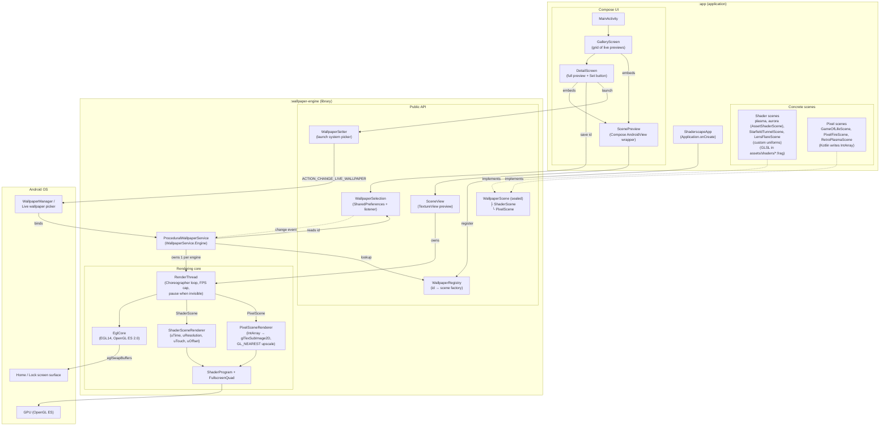
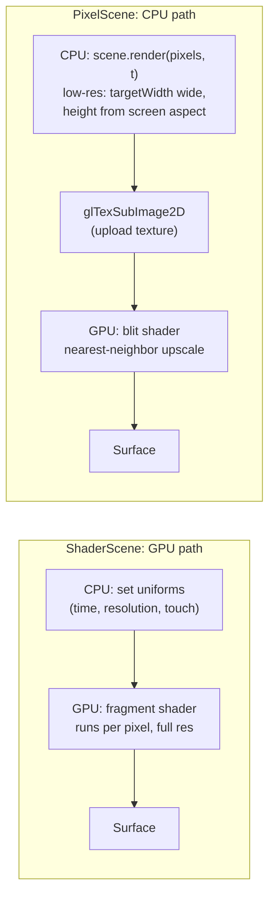
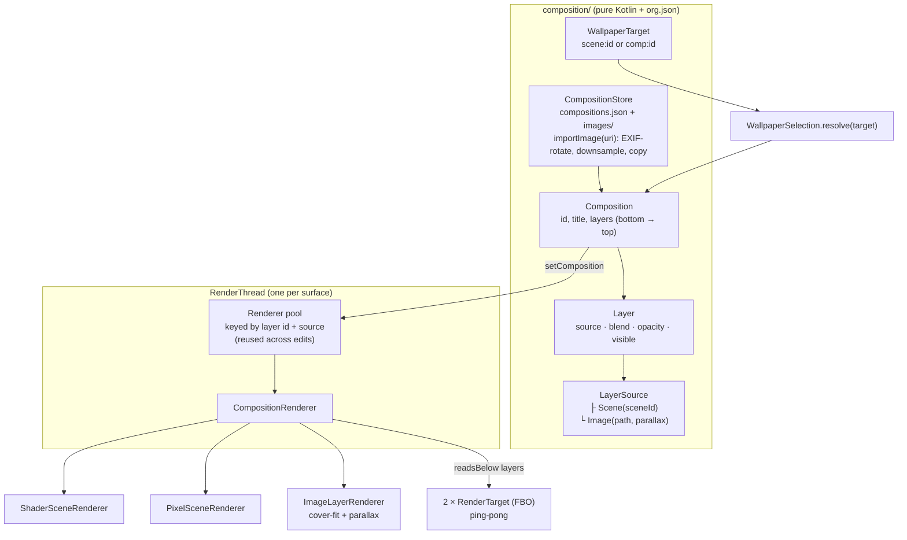

# Shaderscape architecture: procedural live wallpapers

Two Gradle modules:

| Module | Type | Responsibility |
|---|---|---|
| `:wallpaper-engine` | Android library | Scene API, registry, selection store, EGL/GL render thread, renderers, `WallpaperService`, in-app preview view |
| `:app` | Android application | Registers concrete scenes (shader + pixel), Compose gallery/detail UI, "Set wallpaper" action |

## High-level component diagram

## Rendering paths

## Key design rules
- **One pipeline:** both scene types draw through the same EGL surface and full-screen quad.
- **One service, many scenes:** a single `ProceduralWallpaperService` hosts every scene and composition. It shows whatever `WallpaperTarget` `WallpaperSelection` holds, and a change (or an edit to the active composition) swaps it live.
- **One `RenderThread` per surface:** home, lock and system preview engines and each in-app preview get their own thread and GL context.
- **Battery:** render only while visible, cap the FPS (30 by default, ~15 for gallery thumbnails), draw photo-only stacks once instead of continuously, and release GL resources on surface destroy.
- **Extensibility:** adding a wallpaper means subclassing `ShaderScene` or `PixelScene` and registering it. No engine changes are needed.

## Layered compositions

Everything the engine renders is a **`Composition`**: layers ordered bottom to top, each with a source, a blend mode, an opacity and a visibility flag. A plain scene is just a one-layer composition (`Composition.ofScene`), so the single-scene flows above go through the same path.

### Blending
Each layer's output is **premultiplied alpha with opacity applied**. For shader scenes, the engine wraps the author's `main()` with a footer that does this, so blend modes are fixed GL blend functions with no per-scene code:

| Mode | `glBlendFunc` |
|---|---|
| Normal | `ONE, ONE_MINUS_SRC_ALPHA` |
| Add | `ONE, ONE` |
| Screen | `ONE, ONE_MINUS_SRC_COLOR` |
| Multiply | `DST_COLOR, ONE_MINUS_SRC_ALPHA` |

Scenes get `uLayered = 1` when they aren't the bottom layer. Aurora and Lens Flare then drop their sky and output brightness as alpha, so they overlay a photo cleanly.

### Two compositing paths
- **Fast path** (no layer reads below): every layer blends straight onto the window surface.
- **Read-below path** (any visible layer has `readsBelow = true`, e.g. Ripples): layers composite into offscreen target A. A read-below layer first copies A into B, then draws over B, sampling A as `uBelow`. Then A and B swap. A final blit puts A on screen. This costs one extra full-screen copy per read-below layer.

### Limits
`Composition.MAX_LAYERS = 5`, enforced by the store and the editor. Every visible layer is a full-screen pass, so fill-rate is the cost to watch. Debug builds log the average CPU draw time every 5 s (`RenderThread … avg draw`).

## Agent skill provider

The app is also a **skill provider** for on-device agents, through the [Agent Skill SDK](../../agent-skill-sdk/README.md):
- **`skill/WallpaperSkillService`** exposes three tools: `create_shader_wallpaper`, `revise_shader_wallpaper` and `list_my_wallpapers`. It's guarded by the SDK's signature permission.
- **`ShaderTidier`** fixes formatting mistakes before checking. **`engine/validation/ShaderValidator`** then checks agent-written GLSL on an offscreen GPU context, using the same header, footer and renderer as the live wallpaper. It returns fixable errors with the author's line numbers.
- **Valid shaders become drafts** (`CompositionStore` `drafts.json`): a single `LayerSource.Shader` layer, i.e. inline GLSL with no registry entry.
- **The agent receives a preview artifact**, a PendingIntent to `skill/PreviewActivity`. There the user tries the wallpaper and chooses Save, Set as wallpaper, Edit layers (composer) or Discard. The agent can never save or apply anything itself.

Full design: `agent-skill-sdk/design-docs/`.
