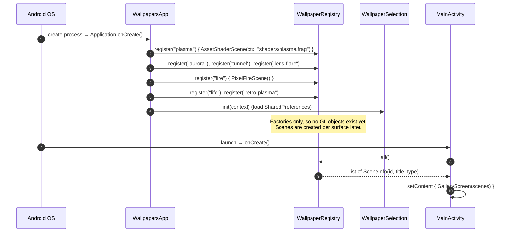
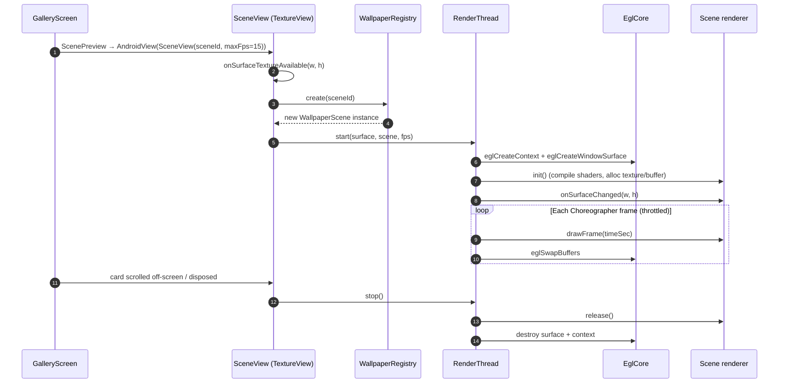
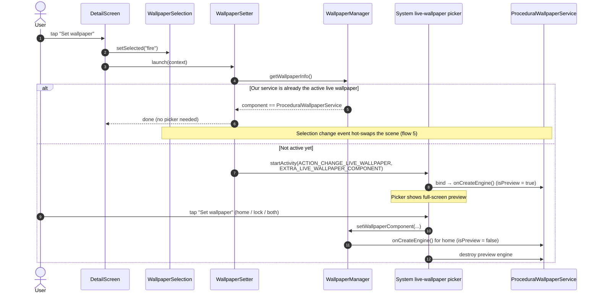
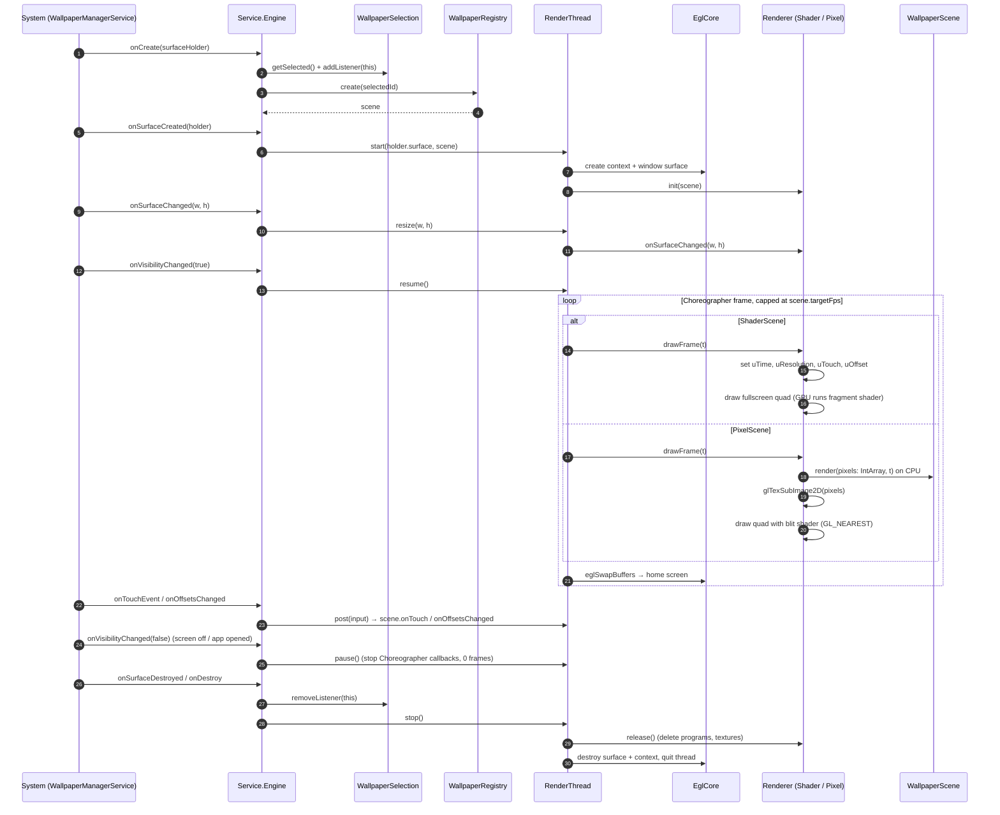
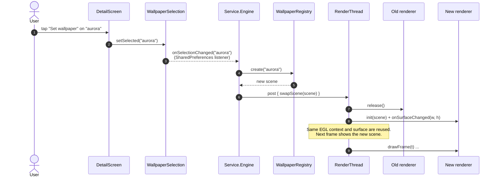
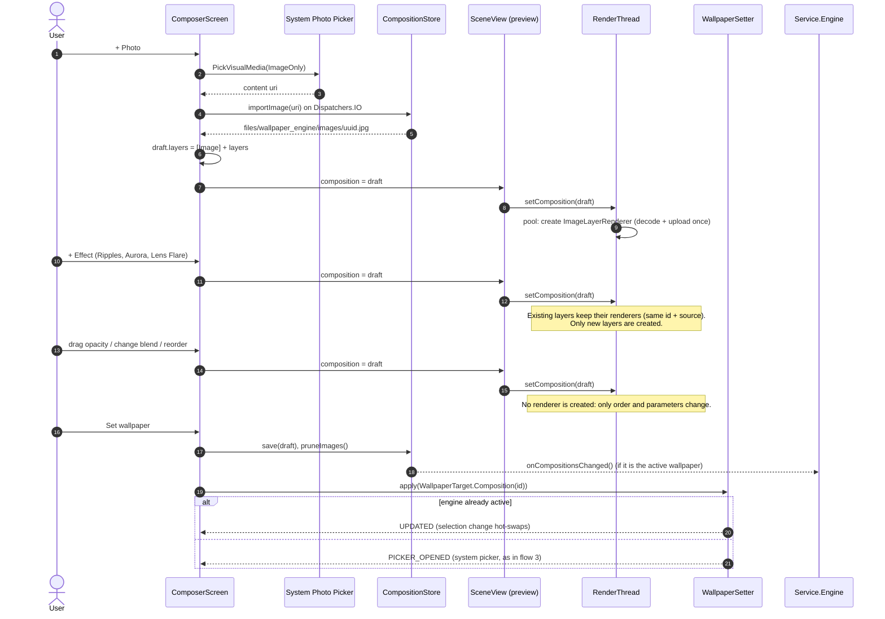
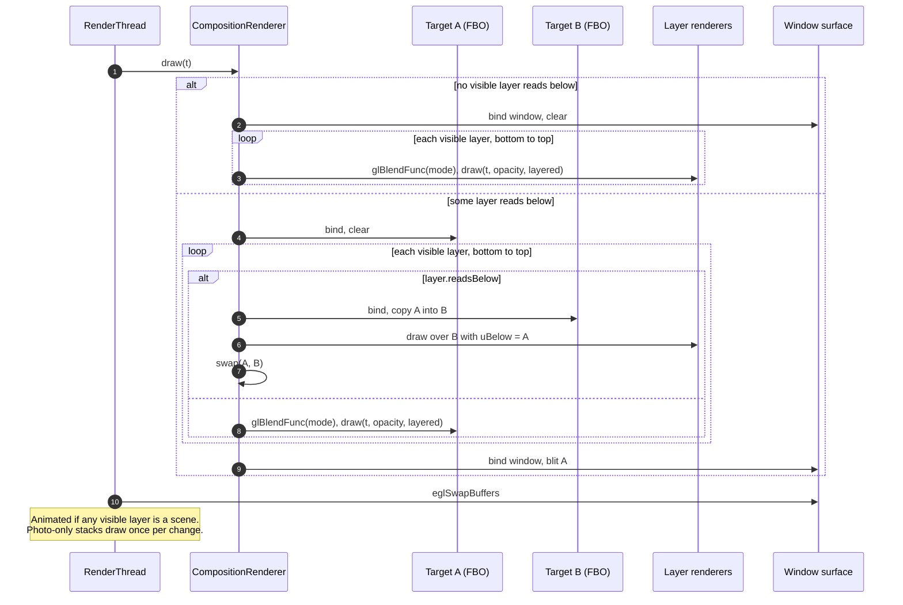

# Sequence Flows

The end-to-end flow from process start to an animating home screen, in five stages:

1. [App init and scene registration](#1-app-init-and-scene-registration)
2. [Gallery and in-app preview](#2-gallery-and-in-app-preview)
3. [Setting the wallpaper](#3-setting-the-wallpaper)
4. [Wallpaper service engine and frame loop](#4-wallpaper-service-engine-and-frame-loop)
5. [Hot-swapping the scene](#5-hot-swapping-the-scene)
6. [Composing and saving a layered wallpaper](#6-composing-and-saving-a-layered-wallpaper)
7. [Drawing one layered frame](#7-drawing-one-layered-frame)

---

## 1. App init and scene registration

> The service process path also runs `Application.onCreate()`, so the registry is always populated before `ProceduralWallpaperService` looks anything up.

---

## 2. Gallery and in-app preview

---

## 3. Setting the wallpaper

> Fallback: if `ACTION_CHANGE_LIVE_WALLPAPER` isn't resolvable, `WallpaperSetter` opens `ACTION_LIVE_WALLPAPER_CHOOSER`.

---

## 4. Wallpaper service engine and frame loop

---

## 5. Hot-swapping the scene

When our service is already the active wallpaper and the user picks another scene in the app:

---

## 6. Composing and saving a layered wallpaper

## 7. Drawing one layered frame

